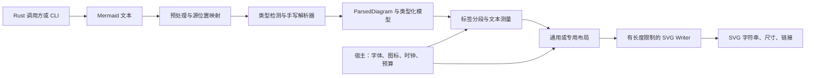

# zebra-mermaid：Pele 的 Rust 重写技术方案与实施路径

调研日期：2026-10-19。首要场景已确认：**Rust 库 + CLI**。

文档中的命令以仓库根目录为起点。

**新增硬性验收（2026-10-19）：Pele 全部测试 1:1 平移并通过。** 包括网站和浏览器测试，参数行、重复标题逐项映射；保留全部断言、输入、种子、循环及阈值。上游 skip/todo 不计为通过；输入采集与 SVG 差分是补充验证。完整清单、当前结果及可执行门禁见 [全量测试移植](UPSTREAM-TEST-PARITY.md)。此要求扩大原先仅 Rust 核心 + CLI 的测试验收范围，原有估计不代表新范围完成度。

**新增必要要求（2026-10-19）：兼容当前 Zebra 的主题配置接入方式。** 按 [Zebra 主题兼容契约](ZEBRA-THEME-COMPATIBILITY.md) 实现现有 `MermaidRenderPalette` / `MermaidPalette` 的 JSON 字段、语义色、明暗模式、字号和透明画布选项，在 P1 开始接入，随每种图表加入测试。Zebra 原生输出使用 resolved 具体颜色。完整 palette 参与渲染身份；仅有 Pele CSS variables 支持不算完成这项要求。

## 1. 建议与交付边界

建议采用 **纯 Rust 同步渲染核心 + CLI**，移植 Pele 的手写解析器、文本测量、布局和 SVG 输出逻辑，先建立差分验证，再做 Rust 特有的优化。

第一项可验收成果是 `pie` 的完整纵向链路；第一个可用版本覆盖 `flowchart`、`sequence`、`pie`、`info`；随后优先补齐 `class`、`state`、`er`，最后逐批覆盖全部 33 类图表。MVP 是阶段性子集，不能标为“完整替代 Pele”。

Rust 库在运行时无需 JavaScript 引擎、Node、浏览器或外部布局程序；开发和兼容性测试保留 Node 运行固定版本 Pele/Mermaid 作为参照。WASM、C ABI、图片导出属于后续适配方向。

重写的主要收益是原生应用/服务嵌入、单文件 CLI、显式资源预算、批量处理和可测试的独立模块。Pele 本身已很快；Rust 的速度和体积优势必须实测，不预先承诺倍数。

## 2. 固定调研基线

| 项目 | 本次核验结果 |
| --- | --- |
| 上游仓库 | `https://github.com/obsidianmd/pele` |
| 固定提交 | `44da152bbb79b91f03e68016f42499bb25bf6e82` |
| 提交时间 | 2026-10-18 09:34:29 -07:00 |
| 提交主题 | 中文和日文标签按字符换行 |
| package.json 版本 | `1.6.0`；本次检查的是该源码提交，并非核验 npm 发布包 |
| 声明的 Mermaid 语法目标 | `12.1.0`；兼容测试文件头记录 Mermaid 提交前缀 `21f72f07ea` |
| 图表类型 | 33 类，依据 `src/entries/` 和注册表 |
| 规模 | 287 个 TypeScript 源文件，50,037 个物理行，含空行、注释和生成数据 |
| 测试文件 | 291 个 `.test/.spec` 文件，其中 136 个位于 `tests/compat` |
| 运行库测试 | 288 个文件通过，1 个文件跳过；6,695 项通过，103 项跳过，2 项 todo |
| 语料 | 33 份文档语料共 522 条，另有 239 条 Agentflow 参考记录，共 761 条，未做全局去重 |
| 语料复跑 | 702 条成功解析并渲染；59 条参考记录被拒绝，文档示例全部渲染成功 |
| 开发依赖 | 包含测试工具、Jison、Mermaid parser 等；`package.json` 没有运行时依赖项 |

来源：[固定版本源码](https://github.com/obsidianmd/pele/tree/44da152bbb79b91f03e68016f42499bb25bf6e82)、[package.json](https://github.com/obsidianmd/pele/blob/44da152bbb79b91f03e68016f42499bb25bf6e82/package.json)、[兼容性说明](https://pele.run/compatibility)。源码统计和运行结果见 [pele-baseline.json](research/pele-baseline.json)。

“支持所有类型”不代表与 Mermaid 的所有行为或像素一致。Pele 使用自己的布局、SVG 标签和主题体系；ZenUML 等外部插件不在覆盖范围内。上游跳过项也说明了 DOMPurify 序列化、Mermaid DOM 渲染、主题 CSS 和 Jison 对象结构等差异，不能把这些跳过项直接统计为 Rust 的已实现功能。

## 3. 上游真实架构与移植映射

Pele 的调用链是预处理、识别图表、图表专用解析、生成模型、测量文本、布局、写出 SVG。`mount` 和缩放是附加的浏览器层。

| 上游文件/模块 | 实际职责 | 建议 Rust 位置 |
| --- | --- | --- |
| `src/core.ts`、`detect.ts`、`types.ts` | 注册表、识别、入口、限制、错误处理 | `engine.rs`、`detect.rs`、`options.rs` |
| `preprocess.ts`、`util/yaml.ts` | frontmatter、指令、注释、实体编码、小型 YAML reader | `preprocess/`、`config/` |
| `diagrams/*/{lexer,parser,db,model,types}.ts` | 按图表类型解析与构造语义模型 | `diagrams/<type>/{lexer,parser,model}.rs` |
| `layout/layered.ts` | 平面图分层布局，1,896 行 | `layout/layered.rs` |
| `layout/compound.ts` | 复合图、嵌套子图、跨组连线，487 行 | `layout/compound.rs` |
| `layout/lanes.ts` | 泳道布局，629 行 | `layout/lanes.rs` |
| `text/*` | 标签分段、实体、换行、测量、图标 | `text/` |
| `svg/*` | 图形、路径、样式过滤、文本和根 SVG | `svg/` |
| `diagrams/*/render.ts` | 图表特定的排版与绘制，共享部分公共布局 | `diagrams/<type>/render.rs` |
| `mount.ts`、`zoom.ts`、`window.ts` | DOM、字体加载、容器变化、错误显示、缩放 | 后续 `packages/web/`，不进入 Rust 核心 |
| `tests/compat`、`tests/support`、`tests/corpus` | 上游规范、适配器、参考解析器、语料 | `tools/compat/` + Rust fixture tests |

来源：[入口](https://github.com/obsidianmd/pele/blob/44da152bbb79b91f03e68016f42499bb25bf6e82/src/core.ts)、[布局源码](https://github.com/obsidianmd/pele/tree/44da152bbb79b91f03e68016f42499bb25bf6e82/src/layout)、[测试说明](https://github.com/obsidianmd/pele/blob/44da152bbb79b91f03e68016f42499bb25bf6e82/CONTRIBUTING.md)。

关键发现：

- `flowchart`、`class`、`state`、`er`、`requirement`、`agentflow`、`usecase` 直接复用复合图布局。先验证这部分，可降低后续多个类型的风险。
- `swimlane` 复用 flowchart 解析器和模型，但使用独立泳道布局。其 71 行入口模块不代表完整功能只需移植 71 行。
- `sequence`、Gantt、Sankey、树图和各种统计图有自己的排版规则；不能全部塞进通用有向图布局。
- Pele 的 `parse` 返回模型后，内部用 `WeakMap` 保存类型与配置关联；Rust 应用显式的 `ParsedDiagram` 保存这些元信息。
- 图标 resolver、测量缓存、注册表含模块级状态。Rust 应把可变状态放进实例或每次渲染的 context，避免多线程和重入时互相影响。

## 4. Rust 核心设计

### 4.1 数据流



首版使用一个库 crate 内的清晰模块，不按 33 种类型拆成 33 个 crate。布局内部采用连续数组、索引和 `f64`，接近上游算法的数据布局；解析模型与布局工作缓冲分开，便于同一模型反复按不同宽度渲染。

### 4.2 公共 API 草案

下列代码是接口设计示意，类型和实现尚未创建：

```rust
pub fn detect_type(source: &str) -> Result<Option<DiagramType>, Error>;
pub fn supports(source: &str) -> bool;

pub fn parse(
    source: &str,
    options: &ParseOptions,
) -> Result<ParsedDiagram, Error>;

pub fn render(
    source: &str,
    options: &RenderOptions,
) -> Result<RenderResult, Error>;

pub fn render_parsed(
    document: &ParsedDiagram,
    options: &RenderOptions,
    context: &mut RenderContext<'_>,
) -> Result<RenderResult, Error>;

pub struct RenderResult {
    pub svg: String,
    pub width: f64,
    pub height: f64,
    pub diagram_type: DiagramType,
    pub links: Vec<LinkInfo>,
}

pub trait TextMeasurer {
    fn width(&mut self, text: &str, size: f64, style: TextStyle) -> f64;
}
```

`RenderOptions` 组合解析选项、布局选项、输出选项；`render_parsed` 不再应用解析期配置。`ParsedDiagram` 保存 `DiagramType`、生效配置、标题、源位置映射与 `DiagramModel` 枚举。公共模型接口先保持只读，不承诺与上游 JS class/DB 对象结构逐字段相同。

错误保留 `unsupported-diagram / syntax / semantic / limit` 分类，提供行、列、片段和字节 span。CLI 的读写失败单独标为 I/O 错误。`supports` 只检查能否识别且当前构建是否启用了该类型，不代表源文本语法正确。

类型注册首版采用静态枚举与 Cargo features；不需要全局可变注册表。可提供 `standard` 和 `all-diagrams` 功能组，具体默认组随里程碑扩展。Cargo features 会合并，精简构建必须使用 `--no-default-features` 并测试功能组合。

### 4.3 解析与预处理

首选手写状态 lexer 和递归下降/显式栈 parser，沿用 Pele 的状态转换和 token 优先级。先覆盖已有语法，再决定哪些简单 token 值得用库处理。直接换成通用 PEG、正则集合或另一套 Mermaid parser，会同时引入接受语法、错误位置和性能上的差异。

预处理需覆盖 CRLF、YAML frontmatter、`%%` 注释、`%%{init}%%` 指令、配置合并、标题、实体编码和末尾换行。保存变换到原始源码的映射；不能只记一个 frontmatter 行数，然后假设所有后续字符偏移都不变。

第一版移植 Pele 的小型 YAML reader。它约 450 行，且上游已有与 `js-yaml` 不一致的已知宽松行为。通用 YAML 库可以作为后续备选，但必须通过兼容性语料验证标量类型、重复键、别名、深度、特殊浮点值和错误语义。[Saphyr 文档](https://docs.rs/saphyr/latest/saphyr/) 可用于评估，首版不把它加入关键路径。

配置需要专门的 `ConfigValue`，不能假定所有输入都能无损放进 `serde_json::Value`：上游 reader 可能产生 NaN/Infinity。应记录并在具体配置读取点按上游行为处理；导出的测试 JSON 对特殊值使用明确的带类型表示。

### 4.4 布局

按算法阶段移植 `layered`：处理环与方向、分层、虚拟节点/标签节点、减少交叉、坐标分配、端点分散、路径轨道、标签避让与收紧。先保持排序规则、循环次数和退化策略，再优化。

随后移植 `compound` 的层级结构、组间端口、跨子图路由和独立子图方向。不能仅靠“对子图先布局，再摆放外框”替代跨组边的完整路由。最后加 `lanes`，验证公共 rank 和泳道边界。

优先使用 `Vec<Node>`、`Vec<Edge>`、邻接索引和专用 ID 类型；避免用 `Rc<RefCell<_>>` 表达可变图。外部节点名到 ID 的映射使用保序结构，几何遍历始终按显式序号执行。

首版不引入 Graphviz、Dagre/ELK 桥接或新布局库。换算法会扩大视觉差分范围，也会失去基于 Pele 已有测试定位问题的优势。

### 4.5 文本测量与中文

默认 `MetricsMeasurer` 移植上游 Arial 宽度估计表、粗体/等宽处理和 CJK/零宽规则，让无字体环境下的结果有可比较的基线。它是估算器，不能宣称有完整字体 shaping 或精确字形宽度。

保留 `TextMeasurer` 注入点。需要实际字体的宿主可提供字体度量；未来字体功能单独启用，并保证测量字体与最终显示字体一致。缓存 key 至少包括文本、字号、样式、字体标识/版本，避免换字体后沿用旧宽度。

标签解析需保留 `<br>`、转义换行、粗体、斜体、Markdown 强调、图标留位和实体解码。中文、日文换行以当前提交行为为基线；后续若采用完整 Unicode 分行或字素簇规则，应作为明确改进单独验证，避免悄悄改变兼容输出。

### 4.6 SVG 与输出模式

用专门的 `SvgWriter` 写入 `String`，集中负责属性和文本转义、数值格式化、XML 控制字符处理、允许的样式和 URL。控制节点/属性生成路径；不将图表文本拼成任意原始 SVG。

建议两种模式：

- `color-mode=css`：保留 `--pele-*` 变量与类名，适合嵌入现有网页；库的 Pele 兼容模式优先使用它。
- `color-mode=resolved`：由调用方明确提供主题参数，生成不依赖外部 CSS 变量的 SVG，作为 CLI 默认输出和 Zebra 原生接入模式，方便独立文件和其他 SVG 消费者使用。

`theme=light|dark`、`palette` 和 `canvas-background=opaque|transparent` 是独立选项。接受 Zebra 当前的 camelCase palette JSON；具体字段、默认规则、透明背景及缓存约束见 [Zebra 主题兼容契约](ZEBRA-THEME-COMPATIBILITY.md)。

resolved 模式还需处理内部变量、字体、半径和字重等引用；不是简单替换几个颜色字符串。两种模式分别建立基线。固定尺寸、`viewBox`、响应式行为、可访问性标题和每图唯一的 ID 前缀都要保留。

可信图标通过 `IconResolver`/已验证的图标表输入。图标名称必须先解析为受控 key，不能直接作为文件路径或原始 markup；核心渲染器不加载网络资源。

## 5. Rust 迁移中特别容易出错的地方

| 风险 | 实施方式与验收 |
| --- | --- |
| UTF-16 与 UTF-8 | 核心 span 用字节；兼容列号与上游长度限制按 UTF-16 code units 映射。明确区分字节、Unicode scalar、字素簇和显示列。补充 emoji、组合字符、中文与非 BMP 样例 |
| 正则语义 | JS `\w`、空白、sticky 匹配、大小写与 Rust Unicode regex 默认行为不同；关键 token 使用显式规则，逐项比较 |
| 数值与排序 | 布局用 `f64`；保留声明次序与稳定 tie-break。实现经过样例验证的 JS 舍入规则，尤其负数半值；SVG 坐标保留上游两位小数格式 |
| Map/Object 枚举顺序 | 使用显式序号与保序映射；对 JS Object 数字样式 key 的顺序另外测试，不能假定所有对象都是插入顺序 |
| YAML/指令合并 | 固定预处理规则与配置优先级；宿主资源限制不允许被图表内配置覆盖 |
| Gantt 日期 | 注入 `now` 和时区策略，测试月份边界、DST、排除日、持续时间。保留格式解析的兼容适配，不能直接把格式字符串交给另一套日期库 |
| 可变 DB 与重绘 | `ParsedDiagram` 保存语义模型；布局修改工作副本。测试同一模型按宽/窄/宽顺序重复渲染，以及多线程独立渲染 |
| 堆栈与内存 | 显式深度检查/迭代栈；Rust 栈溢出不能照搬 JS 捕获 `RangeError` 的策略。追加输出前检查预算，边展开前检查乘法溢出与数量 |
| CSS 和链接 | 迁移 URL 解码、协议过滤、样式白名单与内部笔记链接区别；`url` crate 只承担 URL 标准解析，不承担安全策略 |

相关源码：[文本测量](https://github.com/obsidianmd/pele/blob/44da152bbb79b91f03e68016f42499bb25bf6e82/src/text/measurer.ts)、[标签](https://github.com/obsidianmd/pele/blob/44da152bbb79b91f03e68016f42499bb25bf6e82/src/text/label.ts)、[数值输出](https://github.com/obsidianmd/pele/blob/44da152bbb79b91f03e68016f42499bb25bf6e82/src/svg/builder.ts)、[日期处理](https://github.com/obsidianmd/pele/blob/44da152bbb79b91f03e68016f42499bb25bf6e82/src/diagrams/gantt/dates.ts)。

## 6. 资源预算与安全行为

兼容模式保留源文本 50,000、SVG 4,000,000、flowchart/agentflow 5,000 条边的默认限制；前两项在 JS 中实际按 UTF-16 code units 计算。另设 Rust 字节分配预算，避免把字符串字符上限误当成内存上限。

移植内部预算：YAML 深度 64、分层布局虚拟节点 20,000、复合图端口 40,000，以及泳道路由、Gantt 计算工作量的限制。区分超限报错与上游采取简化路由的情形，并在严格资源策略中记录额外限制带来的兼容差异。

错误信息按纯文本返回；URL 必须经过规范化和协议白名单，保留始终禁止的协议。外部图片默认策略由宿主/CLI 选项控制，渲染引擎只写 URL，不发起下载。复用上游恶意标签、链接、样式、深层嵌套、组合边扩张等测试。

若需要硬超时，由 CLI 隔离子进程或宿主可终止 worker 执行；普通线程无法可靠强制终止任意正在运行的 Rust 函数。核心增加可协作检查的工作预算，时间检查通过宿主提供，避免在算法中隐式依赖系统时钟。

来源：[Pele 安全行为](https://pele.run/security)、[URL 源码](https://github.com/obsidianmd/pele/blob/44da152bbb79b91f03e68016f42499bb25bf6e82/src/util/url.ts)。

## 7. CLI 设计

以下为计划命令，当前尚不可执行：

```sh
# 单文件与管道
zebra-mermaid render diagram.mmd -o diagram.svg
cat diagram.mmd | zebra-mermaid render - > diagram.svg

# 校验与机器可读错误
zebra-mermaid check diagram.mmd --format json

# 指定宽度、输出样式和固定日期
zebra-mermaid render diagram.mmd --max-width 800 --color-mode resolved \
  --now 2026-10-19T00:00:00Z --timezone UTC -o diagram.svg

# 批量处理；默认保留输入的相对目录层级
zebra-mermaid batch ./diagrams --out-dir ./svg --jobs 4
```

CLI 用 stdout 输出结果，stderr 输出诊断，SVG 管道中不混入日志。建议退出码：`0` 成功、`2` 参数错误、`3` 不支持/语法/语义错误、`4` 资源限制、`5` I/O 错误；JSON 同时保留细分错误码。批量任务汇总每个文件的状态，任意失败返回非零。

输出文件用同目录临时文件写完后再替换；缺省拒绝覆盖已有文件，`--force` 明确允许覆盖。批量模式预先检查输出路径冲突和输入输出目录重叠。`--jobs` 的并发限制作用在图与图之间，单张图的算法先保持确定性。

只支持 UTF-8 输入，错误指明字节位置；支持 stdin 的字节上限检查。首版输出 SVG，PNG/PDF 导出在后续通过独立适配器实现。

## 8. 依赖与适配策略

| 范围 | 建议 | 选择理由与约束 |
| --- | --- | --- |
| 核心模型/fixture | `serde`；CLI/测试层使用 `serde_json` | API 数据和差分记录；特殊浮点值用显式表示 |
| 保序映射 | `indexmap` | 替代依赖声明次序的 JS Map；默认保留抗哈希碰撞的 hasher |
| URL 标准解析 | `url` | 放在自有安全策略之后，保留相对地址，不伪造 base URL |
| 解析器、YAML、布局、SVG writer | 首版自有模块，按 Pele 行为移植 | 缩小差分范围、减少运行时依赖 |
| CLI 参数 | 第一阶段可手写少量参数；命令稳定后评估 `clap` | 不让 CLI 依赖进入库的必要依赖集 |
| 属性与基准测试 | `proptest`、`criterion` | 生成边界输入、缩减反例、统计性能回归 |
| SVG 测试 | `quick-xml` 作为测试依赖 | 解析并检查 XML 结构；无需用于首版生产 SVG 写出 |
| WASM（后续） | `wasm-bindgen`、`serde-wasm-bindgen` | Rust/JS 数据桥接；宿主 DOM 层独立维护 |

依据：[IndexMap](https://docs.rs/indexmap/latest/indexmap/)、[URL](https://docs.rs/url/latest/url/)、[Proptest](https://docs.rs/proptest/latest/proptest/)、[Criterion](https://docs.rs/criterion/latest/criterion/)、[quick-xml](https://docs.rs/quick-xml/latest/quick_xml/)、[wasm-bindgen](https://wasm-bindgen.github.io/wasm-bindgen/)、[serde-wasm-bindgen](https://docs.rs/serde-wasm-bindgen/latest/serde_wasm_bindgen/)。版本在实施时验证目标平台与 MSRV 后锁定，不从此文中的“latest”链接隐式追踪升级。

后续 WASM 需先完成异步模块初始化，此后 `render` 可以同步调用。保留 JS 的 `mount`、ResizeObserver、字体加载及缩放处理。字体测量先使用有缓存的宿主 callback；只有实测跨边界调用是瓶颈时再引入批量测量/缺失项回填，避免按单字频繁往返。

Cargo feature 裁剪不等于浏览器运行时按类型懒加载。初期发布少量固定构建组合；如确实需要 `pele/lazy` 同等体验，再设计多模块分包与共享核心。

原生应用可直接调用 Rust 库；其他语言按需求增加 `zebra-mermaid-ffi`。C ABI 使用不透明句柄、明确分配/释放函数、指针加长度与错误状态；不能直接跨边界传 Rust `String`、`Vec` 或让 panic 展开到宿主。

## 9. 验证方法：三个不同的参照

1. **Mermaid 12.1.0 语法参照**：沿用 Pele vendored grammar、parser specs 与差分 adapter，比较接受/拒绝、token/模型构建事件、语义数据。不能只测试“是否能生成 SVG”。
2. **固定 Pele 提交的行为与几何参照**：固定测量器、字号、ID、宽度、时间和时区，对比模型、链接、错误、几何和 SVG；针对每类 DB 定义显式可序列化视图，保留数组顺序、Map、日期等语义。
3. **Rust 自身的不变量**：XML 可解析、坐标有限、尺寸合理、重复执行确定、资源超限可控、恶意输入不 panic、多个 context 相互独立。

上游 103 个 skipped 和 2 个 todo 必须建账，按“适用于 Rust”“JS/DOM 专属”“已知语义差异”分类。对于不属于兼容范围的断言记录原因；已经承诺支持的行为不能借用上游跳过标记规避验证。

测试阶段：

- 导出 JSONL fixture：原始 source、options、测量器标识、预期成功/错误、标准化模型、几何与链接。
- 从简单 `pie` 开始，Rust 与 Pele 对同一输入和字体度量做差分。
- 对 flowchart 的四方向、环、自环、多重边、嵌套子图、跨组边、标签、样式、中文做定向测试。
- 每类 parser 接入上游语料和固定 seed 的变异输入，再运行 Rust 的 property tests；失败样例缩减后固定入库。
- 可见输出使用固定浏览器、固定字体截图回归。额外做 CLI resolved SVG 的结构和渲染测试。

对离散数据要求完全一致；对几何先在未舍入结果上采用严格小误差门槛，初始建议 `1e-6`，输出坐标以 0.01 px 格式为对照。如存在不同数学函数引起的差异，逐例批准容差，不能用宽松截图阈值掩盖拓扑/标签变化。XML 属性顺序可以规范化，但不能排序会影响绘制层叠的元素。

不要求与 Mermaid 的像素布局一致；目标是记录清楚的 Mermaid 语义兼容及 Pele 布局迁移一致性。来源：[上游 flowchart 差分测试](https://github.com/obsidianmd/pele/blob/44da152bbb79b91f03e68016f42499bb25bf6e82/tests/flowchart/oracle.test.ts)、[Agentflow 已知差异](https://github.com/obsidianmd/pele/blob/44da152bbb79b91f03e68016f42499bb25bf6e82/tests/agentflow/reference.test.ts)。

## 10. 性能基线与验收口径

运行时：Node v26.3.0。使用上游 `npm run bench`；默认 Node 字体估算，不含浏览器 DOM 插入或实际字体测量。以下为该脚本的批次中位数，尚不是隔离环境下的 p95，也没有 Rust 对照。

| 输入 | Pele 耗时 |
| --- | ---: |
| 114 条 flowchart 文档示例，整批 | 2.9 ms |
| 50 节点树 | 0.250 ms |
| 50 节点图 + 20 条额外带标签边 | 0.805 ms |
| 500 节点树 | 3.4 ms |
| 500 节点图 + 200 条额外带标签边 | 9.0 ms |

本次构建的全量 ESM 为 678,032 bytes（662.1 KiB），gzip 为 251,692 bytes（245.8 KiB）。这是源码构建实测，不能把官网不同快照的展示值当成这个提交的值。

Rust 验收拆分 `parse`、文本布局、图布局、SVG 输出、完整渲染和 CLI 冷启动，分别测量重复渲染及批量吞吐。库的热路径比较必须使用同一组语料、同一测量器、同一选项，输入失败数量也必须相等；不能用预解析 Rust 与“解析+渲染”JS 比较，也不能用 CLI 进程时间对比 JS 进程内函数。

首轮建议的候选性能门槛：在隔离重复测试和置信区间下，各主要类别的热渲染不比固定 Pele 基线持续慢 20% 以上；更高性能作为优化目标而非首版承诺。另记录峰值内存、分配次数、冷启动和发布体积，并在 P0 决定可接受预算。跨语言对照依赖专用重复运行脚本，Criterion 用于 Rust 内部定位回归。

来源：[上游 benchmark 脚本](https://github.com/obsidianmd/pele/blob/44da152bbb79b91f03e68016f42499bb25bf6e82/scripts/bench.mjs)。

## 11. 实施阶段与全部类型的迁移顺序

| 阶段 | 交付内容 | 退出条件 |
| --- | --- | --- |
| P0：建立基线 | Cargo workspace、类型/错误契约、固定上游来源、fixture 导出、基准框架 | 同一 fixture 可以分别喂给 TS 和 Rust 测试入口；差异分类清晰 |
| P1：最小闭环 | 预处理、配置、文本、SVG writer、`pie`、`info`、单文件 CLI | 输入→模型→SVG 全链路通过差分；stdin/stdout 与错误码可用 |
| P2：主要难点 | `layered`、`compound`、完整 `flowchart` | 114 条 flowchart 文档示例与适用 parser/安全/布局测试通过；四方向与嵌套子图通过 |
| P3：可用 MVP | `sequence`、批量 CLI、缓存与资源预算 | 4 类图表形成完整验收闭环，发布范围明确；MVP＝flowchart/sequence/pie/info |
| P4：常见软件图 | `class`、`state`、`er` | 7 类覆盖；复合图复用得到验证，公共 API 完成一次稳定性评审 |
| P5：分批补全 | 按下表逐批推进剩余 26 类 | 每个类型都有语义、几何、安全、性能基线与已知差异记录 |
| P6：完整替代与发布 | 33 类收敛、平台构建、文档、许可证、版本策略 | 所有适用用例通过，既有差异显式列出；CLI 安装包可复现 |

全部 33 类分组如下，类型 ID 保留上游写法，避免把大小写差异误认为新的类型：

| 分组 | 类型 | 数量 |
| --- | --- | ---: |
| 基础闭环 | `pie`, `info` | 2 |
| MVP 核心 | `flowchart`, `sequence` | 2 |
| 常见软件图 | `class`, `state`, `er` | 3 |
| 更多公共图能力 | `requirement`, `agentflow`, `usecase`, `swimlane` | 4 |
| 树、列表与常规统计 | `mindmap`, `treeView`, `treemap`, `packet`, `quadrantChart`, `radar`, `xychart`, `timeline`, `journey`, `kanban` | 10 |
| 独立排版/语义 | `gantt`, `gitGraph`, `c4`, `architecture`, `block`, `sankey`, `railroad`, `venn`, `cynefin`, `wardley`, `ishikawa`, `eventmodeling` | 12 |

P5 内可以先做结构简单的图表，但 `agentflow`、`usecase`、Gantt、C4、railroad、Venn 应单独安排验证工作。按类型数量平均分工会低估这些模块。最早应验证的技术风险仍是 flowchart 的 lexer、复合布局和文本测量。

**粗估工作量，仅用于计划：**P0–P3 约 8–14 人周；P4–P6 再需约 16–26 人周。以两名熟悉 Rust/解析器/图布局的工程师持续投入估算，MVP 约 5–9 周，全量约 4–6 个月；这些是基于源码规模与验证范围的判断，尚未经 Rust 原型校准。完成 P2 后应按实际差分修复速度重新估算，不能把代码翻译速度当成交付速度。

首个迭代建议只承诺 P0 + P1，并同步抽取 flowchart 嵌套/跨组样例以提前验证 P2 风险。

## 12. 建议目录结构

以下是实施后目标目录；本轮仅创建了文档、研究基线和研究快照：

```text
zebra-mermaid/
├── Cargo.toml                         # workspace，实施阶段创建
├── Cargo.lock
├── crates/
│   ├── zebra-mermaid/
│   │   ├── Cargo.toml
│   │   └── src/
│   │       ├── lib.rs
│   │       ├── engine.rs
│   │       ├── model.rs
│   │       ├── error.rs
│   │       ├── options.rs
│   │       ├── detect.rs
│   │       ├── preprocess/            # frontmatter、directive、source map
│   │       ├── config/                # YAML reader 与配置值
│   │       ├── text/                  # measure、label、entity、icon
│   │       ├── layout/                # layered、compound、lanes
│   │       ├── svg/                   # writer、geometry、style、URL
│   │       └── diagrams/              # pie、flowchart、sequence 等
│   ├── zebra-mermaid-cli/             # binary 名称 zebra-mermaid
│   └── zebra-mermaid-wasm/            # 后续可选
├── packages/web/                      # 后续 mount/zoom 适配
├── tools/compat/                      # 固定 TS oracle、fixture 导出、差分
├── tests/fixtures/                    # 带来源与许可证的样例/预期
├── benches/
├── fuzz/
├── docs/
│   ├── RUST-REWRITE-PLAN.zh-CN.md      # 已创建
│   └── research/pele-baseline.json    # 已创建
├── THIRD_PARTY_NOTICES.md             # 开始移植代码/测试时创建
├── README.md                          # 已创建
└── .research/                         # 已创建，git 忽略
    ├── pele/                         # 上游源码固定快照
    ├── collect-baseline.mjs
    ├── pele-corpus-cases.json
    ├── pele-tests.log
    ├── pele-build.log
    └── pele-bench.log
```

将来首次实现的推荐文件顺序：`error.rs` → `options.rs`/`model.rs` → `preprocess/` → `text/` → `svg/` → `diagrams/pie/` → CLI。随后单独移植 `layout/layered.rs` 和 `compound.rs`，再接 flowchart。

研究快照不作为 Rust 的运行时依赖，也不把嵌套 Git 仓库提交到项目。后续 `tools/compat` 以提交 SHA 和校验和获取参照代码；需要入库的 fixture 单独保存来源与许可信息。

## 13. 上游许可记录与后续维护

上游源码文件的许可证为 MIT；兼容测试和语法文件另有 Mermaid 的 MIT 来源声明；缩放控件使用的 Lucide reset 图标还在上游 LICENSE 中附带 ISC 声明。开始移植代码、测试或图标时，将适用的原始版权与许可文本一起收入 `THIRD_PARTY_NOTICES.md`/第三方许可文件，不因重写语言而丢失来源记录。首版 Rust+CLI 不必包含浏览器缩放控件。

来源：[固定版本 LICENSE](https://github.com/obsidianmd/pele/blob/44da152bbb79b91f03e68016f42499bb25bf6e82/LICENSE)。

上游升级采用显式流程：记录新提交 → 更新语料 → 运行差分 → 分类新增语法/修复/视觉变化 → 分批移植 → 更新兼容表。首版完成前维持当前基线，避免同时追赶不断变化的上游。

## 14. 本轮验证与复现

已执行：拉取源码并固定提交、统计文件与语料、安装上游开发依赖、运行库测试、构建、执行上游基准、复跑全部 761 条语料记录。未运行网站测试、浏览器字体/截图验证；Rust 引擎、Rust 性能和跨平台结果尚不存在。

现有研究目录可用以下命令复现上游检查：

```sh
cd .research/pele
git rev-parse HEAD
npm ci --ignore-scripts --no-audit --no-fund
npm test
npm run build
npm run bench

cd ../..
node .research/collect-baseline.mjs
```

`collect-baseline.mjs` 会重新测量源码规模、包大小和语料接受结果；其中 `tests` 与 `benchmark` 字段记录的是本轮已执行日志的摘录，不会自动重新跑测试或计时。复测后要同步更新这些记录。完整输出保存在 `.research/`，提交进仓库的摘要为 `docs/research/pele-baseline.json`。

## 15. 实施期修订（2026-10-19，基于固定源码与实测）

以下修订来自实施中的源码核对与测试证据；进度与结果见 [实施状态](IMPLEMENTATION-STATUS.md)。

1. **数学函数可以逐位一致，无需容差。** 第 9 节建议“不同数学函数引起的差异逐例批准容差”。实测 Node v26.3.0（V8 14.6.202.34）的 `Math.sin/cos/tan/asin/acos/atan/atan2/exp/log/log2/log10` 均为 V8 内置 fdlibm（未启用 glibc 三角函数），且 Node 的 clang 构建把 `a*b+c` 收缩为 FMA；按此移植后与 Node 逐位一致。影响：几何差分可以要求逐字节一致，不必引入 `1e-6` 门槛。例外：`Math.pow` 由 V8 交给平台 C 库，Rust 侧同样调用平台 `pow`，因此只在同一操作系统/架构上与 Node 一致。
2. **`TextMeasurer` 采用 `&self`。** 第 4.2 节草案为 `&mut self`。测量在标签与布局深处被多处借用调用，`&self` 更易移植且不妨碍实现内部用可变缓存。影响：宿主实现需自行处理内部可变性（`Cell`/`RefCell`/锁）。
3. **颜色输出分为 `theme`（light/dark）与 `color_mode`（css/resolved），并加入 Zebra 调色板契约**（用户新增要求，已同步到第 4.6、7 节）。实现方式：每个着色点同时给出语义角色与 Pele 原样表达式，css 模式输出与 Pele 逐字节一致，resolved 模式输出角色颜色；不做输出后的全局颜色替换。
4. **差分 fixture 的来源扩大。** 除文档语料外，在复制目录中对上游测试插桩，采集到 70,733 条真实 `render()` 输入，按类型逐字节对照；该集合比文档语料大两个数量级，是布局兼容的主要证据。采集副本中 `browsers.test.ts` 因插桩引入 Node 模块而失败，属采集方式所致。
5. **fixture 固定 UTC 与 `now`。** Gantt 等日期计算依赖宿主时区；oracle 以 `TZ=UTC` 运行，Rust 侧 `timezone_offset_minutes` 默认 0。未设置 `now` 的上游用例在 fixture 中补固定时间。
6. **JSON 指令嵌套深度。** Rust 使用线程栈递归，`%%{init}%%` JSON 限 200 层（超出报 `limit`）；JS 的 `JSON.parse` 无固定上限。属第 6 节“严格资源策略带来的兼容差异”，已列入已知差异。
7. **Zebra 适配的源长度上限。** Zebra 宿主允许 262,144 UTF-16 单位，高于 Pele 默认 50,000；Zebra 适配采用宿主上限，以免拒绝现有可渲染的长图。通用库默认仍为 50,000。
8. **性能需逐项实测与优化。** 首测发现每次分词重建首字符表、每次渲染重建主题会让小图比 Pele 慢数倍；缓存后 pie 已快于 Pele，info 仍约慢 1.75 倍（每图约 1 µs 固定开销）。第 10 节的 20% 门槛需在全部类型完成后统一复测。
